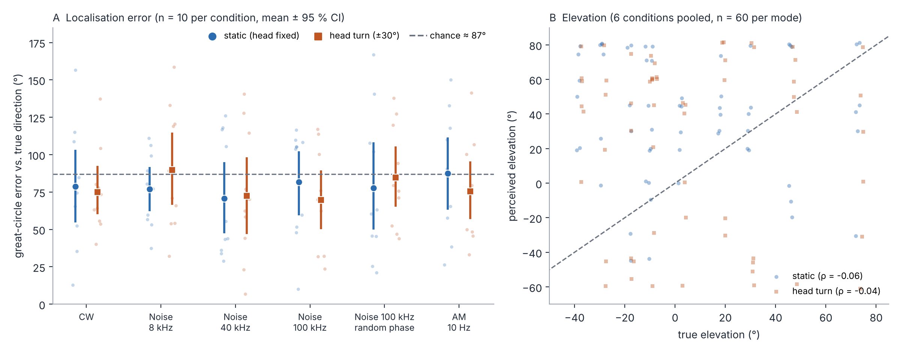

# RFAA sonification and a listening test of its spatial cues

A re-implementation (Python reference + C port) of the spatial sonification pipeline for radio-frequency (RF) fields in Steven J. Todd's Penn State doctoral dissertation (5-antenna "RFAA" array → first-order Ambisonic audio), together with a binaural listening experiment that asks how well a listener can localise the sonified source.

**Relation to the dissertation.** The sonification core (`sonify.py`, `c/sonify.c`) is a port of the MATLAB listing in Appendix C.3, with two documented modifications: (1) the Z channel is sonified as well (`n_pca = 4`; Todd's script is horizontal-plane only, `n_pca = 3` reproduces it), and (2) a deterministic sign-alignment of the principal components (`sign_mode = 'aligned'`; the literal formula is kept as `'thesis'`). The listening experiment — how accurately a human can perceive the direction of arrival in the sonified audio — addresses a next step named in the dissertation's future-work section ("the human perception of the direction of the signal", starting with stationary targets), on simulated data only; it does not assess the real array. Its future-work section also asks for data over the full sphere (not only the horizontal plane), broadband signals and real-time sonification, which this project explores in simulation (3-D sources, noise and AM sources, a C port). The signal types beyond a single tone (noise, AM), the random-phase layer and the virtual head rotation are additions of this project, not part of Todd's work.

Everything runs on **simulated** RF data (no radio hardware; array coefficients are fitted on simulated patterns with an assumed distortion model). This is an independent learning / portfolio project and is not affiliated with Penn State or the dissertation's author. It was developed with the assistance of Claude (Anthropic) for code and analysis; the listening experiments and their interpretation are the author's own.

## Main finding (pilot, one listener)



* With this pipeline the listener localised sonified RF sources only slightly better than chance (≈ 78–79° mean error, chance ≈ 87°). **Left/right is reliable (83 % correct) with the head fixed, elevation is not perceived** (Spearman ρ ≈ 0), and single tone, 8 / 40 / 100 kHz noise and AM sources were not measurably different.
* A control session through the same Ambisonic decoder **without** RF or sonification shows that elevation is conveyed by full-band noise (ρ = +0.70), disappears after a 9 kHz low-pass (ρ = +0.04), and that bright flat noise in the 0.5–9 kHz band of the sonified audio reproduces the upward elevation bias seen in the sonification trials (+32°). Two candidate causes remain and are not yet separated: little high-frequency content after the binaural decode (the sonified audio is flat up to ≈ 11–12 kHz, but only ≈ 0.6 % of the energy at the ears lies above 9 kHz and none above 12 kHz; control A: 3.2 % and 0.9 %), and per-bin direction noise at 40 dB SNR. A 2 × 2 follow-up (tuner × SNR) is planned.
* One listener, 10 directions per condition: treat all of this as exploratory. Full write-up with tables, statistics, limitations and next steps: **[results/RESULTS.md](results/RESULTS.md)**.

## Pipeline

```
rfaa_sim.py            simulated 5-antenna array, calibration, RF signal types (CW, band-limited noise, AM)
   │  5 × complex baseband, 120 kHz
   ▼
sonify.py  /  c/sonify.c   Todd's sonification (power spectra → B-format → PCA → spectrum placement) → 4-ch audio W,X,Y,Z, 30 kHz
   │                       the C port runs file-based or real-time on a stdin stream (c/sonify_cli)
   ▼
listening_trials.py    first-order Ambisonic → binaural (max-rE decode, KEMAR HRIRs), virtual head rotation, trial generator + answer check
   ▼
make_session.py        blind, shuffled sessions mixing several conditions + per-condition statistics
analyze_responses.py   statistics and figure for a set of condition folders
```

## Quick start

```bash
python3 -m venv .venv && source .venv/bin/activate
python -m pip install -r requirements.txt

python3 test_sonify.py                 # checks of the simulator and the sonification (tests [1]-[8])
python3 prepare_hrtf.py                # one-off: writes kemar_hrir.npz from the KEMAR data shipped with `slab`

# 10 random directions, answer key hidden; fill demo/responses.csv, then check:
python3 listening_trials.py --random 10 --seed 31 --signal noise --bw 100000 --out demo
python3 listening_trials.py --check demo/responses.csv --out demo
```

Useful options of `listening_trials.py` (see the docstring for all):

| Option | Meaning |
|---|---|
| `--random N --seed S` / `--az ... --el ...` | random directions (answers saved to a file) or directions you set |
| `--signal cw|noise|am`, `--bw`, `--am-hz` | RF source type |
| `--phase zero|random` | Todd's zero-phase audio or a random-phase presentation layer |
| `--head-turn DEG`, `--head-yaw A,B` | virtual head rotation (extra files per trial) |
| `--reference foa|direct`, `--stimulus noise|tone|whitebw`, `--lowpass HZ` | control conditions without RF/sonification |
| `--engine c --cli c/sonify_cli` | use the C port instead of the Python sonification |

Blind multi-condition session (as used for the control session):

```bash
python3 listening_trials.py --random 10 --seed 41 --reference foa --stimulus noise                    --out A_full
python3 listening_trials.py --random 10 --seed 41 --reference foa --stimulus noise --lowpass 9000     --out B_lp9k
python3 listening_trials.py --random 10 --seed 41 --reference foa --stimulus whitebw --band 500,9000  --out C_flat
python3 make_session.py --build A_full B_lp9k C_flat --out session        # shuffled files + hidden key
python3 make_session.py --check session/responses.csv --key session_key_DO_NOT_OPEN.csv
```

### C port (optional)

```bash
sudo apt install libfftw3-dev           # macOS: brew install fftw
python3 make_golden.py c/golden         # reference vectors from the Python implementation
make -C c && make -C c check            # builds test_golden and sonify_cli, compares C against Python
```

Tested by the author on Linux (`cc -std=gnu11 -O2`, FFTW 3 single precision): all four golden cases pass (audio relative error 2.6–4.4 × 10⁻⁷ against the Python reference, identical number of kept principal components, `n_pca` = 3 vs 4 consistent), and `process_chunk` takes about 0.5 ms on average (max ≈ 1 ms) per 100 ms chunk, i.e. roughly 200 × real time on that machine.

`c/sonify_cli` reads a recording or a live stream of 5-channel complex samples and writes audio; `make_stream.py` produces test streams.

## Repository layout

| Path | Content |
|---|---|
| `rfaa_sim.py`, `sonify.py`, `test_sonify.py` | simulator, reference sonification (Python), tests |
| `c/` | C port (`sonify.c/.h`, `sonify_cli.c`, `test_golden.c`, `Makefile`) |
| `make_golden.py`, `make_stream.py`, `export_wav.py` | golden test vectors, test streams, WAV export |
| `prepare_hrtf.py`, `listening_trials.py`, `make_session.py`, `analyze_responses.py` | listening experiment |
| `results/` | report, figures and raw trial data of the pilot experiment |

## Limitations

Simulated array and signals (the array distortion model is an assumption of this project, not measured hardware; see [Appendix A of the report](results/RESULTS.md#appendix-a-simulated-array-model-and-its-assumptions)); one listener; non-individual KEMAR HRTF; first-order Ambisonics; small numbers of trials, so only large effects can be detected. The C port was validated against the Python implementation with golden vectors (audio relative error ≲ 5 × 10⁻⁷, float32 vs float64; four cases).

## Credits

* S. J. Todd, *Spatial Sonification of Inaudible Scalar and Vector Fields through Immersive Audio*, doctoral dissertation, The Pennsylvania State University, 2025. `sonify.py` and `c/sonify.c` are ports of the MATLAB listing in its Appendix C.3 (with the two modifications above); `rfaa_sim.py` follows Appendix C.1/C.2 (array optimisation and beamformer). The dissertation's code is the author's work and is not redistributed here. **Not licensed for reuse yet** — no LICENSE file is included; please ask before reusing.
* Code written with the assistance of Claude (Anthropic).
* MIT KEMAR dummy-head HRIRs (normal pinna; Gardner & Martin, 1994, MIT Media Lab Perceptual Computing Technical Report #280) as bundled with the [`slab`](https://github.com/DrMarc/soundlab) Python package. The data are not included in this repository; `prepare_hrtf.py` exports them from `slab`.
