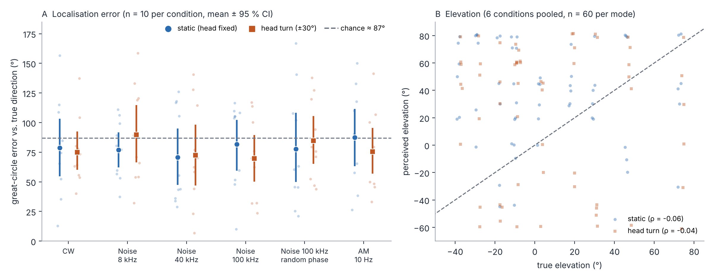
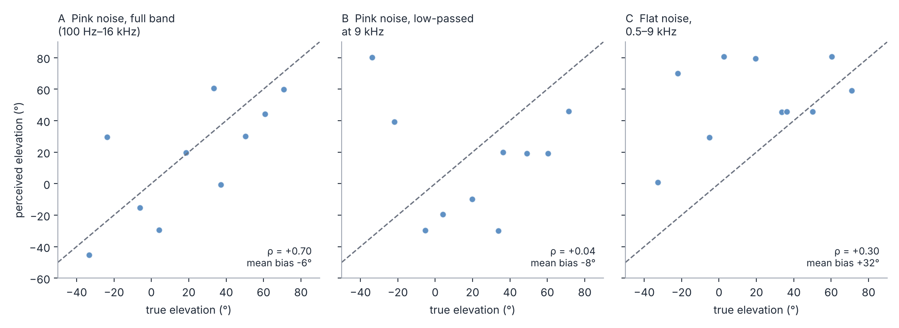

# Preliminary listening test: does RF bandwidth help a listener localise a sonified source?

**Status:** pilot study, one listener, 10 directions per condition, 6 source types, static head and simulated head rotation (120 trials in total).

**Bottom line:** with this pipeline the listener localised sonified RF sources only slightly better than chance (≈ 78–79° mean error vs. ≈ 87° chance). Left/right was reliable with the head fixed (83 % correct), **elevation was not perceived at all**, and no source type (single tone, 8 / 40 / 100 kHz noise, 10 Hz AM) was measurably better than another. Virtual head rotation did not improve the overall error; it roughly halved front/back confusions but made left/right judgements worse. A control session without any RF or sonification (same decoder, ideal first-order Ambisonic noise) shows that the decoder can convey elevation for full-band noise (ρ = +0.70), that removing content above 9 kHz removes this (ρ = +0.04), and that a bright, flat 0.5–9 kHz noise, with a similar spectral balance to the sonified audio, reproduces the upward elevation bias seen in the sonification trials (+32°). This is a negative / inconclusive result for the sonified source, reported together with its likely causes and a concrete next test.

## 1. What was tested

Pipeline (all code in this repository): simulated 5-antenna RF array (`rfaa_sim.py`) → sonification following Todd's Appendix C.3 (`sonify.py`, C port in `sonify.c`) → 4-channel first-order Ambisonic audio (W, X, Y, Z) → binaural rendering with KEMAR HRIRs (max-rE decode to 50 virtual speakers, `listening_trials.py`) → headphones.

Question: Todd's experiments used a single continuous tone, which carries no elevation cue through this decoder. Does a wider RF bandwidth give the listener elevation and front/back information in the sonified audio?

| Condition | RF source |
|---|---|
| CW | single tone (as in Todd's experiments) |
| Noise 8 / 40 / 100 kHz | band-limited Gaussian noise centred on the tone frequency (the baseband window is 120 kHz) |
| Noise 100 kHz, random phase | same spectrum, one random phase per frequency bin, identical for all four channels (overlap-add), removing the 10 Hz pulse train that zero-phase broadband chunks produce |
| AM 10 Hz | tone with 10 Hz amplitude modulation, depth 0.5 (Todd, Appendix B) |

Protocol: the same 10 random directions (azimuth 0–360°, elevation −40 … +80°, fixed seed) in every condition; KEMAR (non-individual) HRTF; over-ear headphones, fixed volume and wearing orientation; simulated SNR 40 dB. *Static*: head fixed. *Head turn*: the Ambisonic field is rotated as if the head swept 0 → +30° → −30° → 0 over 3 s. The listener reported azimuth and elevation for each trial. Conditions were presented in randomised order over four sessions with ≥ 10 min breaks; answers were compared with the truth only after all sessions. The six source-type conditions were presented as separate, labelled folders (not blinded; no feedback was given). Only the control session in §2b was blind and shuffled.

## 2. Results

Error = great-circle angle between answered and true direction. Chance level from permutation of the answers across trials ≈ 87°. 95 % CIs are bootstrap over trials (n = 10).

| Condition | Static: error | L/R correct | elev. ρ | Head turn: error | L/R correct | elev. ρ |
|---|---|---|---|---|---|---|
| CW | 78.6° [55–104] | 8/10 | −0.04 | 75.0° [60–93] | 3/10 | +0.09 |
| Noise 8 kHz | 77.0° [62–91] | 8/10 | −0.55 | 89.8° [66–115] | 7/10 | −0.57 |
| Noise 40 kHz | 70.8° [47–95] | 9/10 | −0.02 | 72.5° [47–98] | 8/10 | +0.42 |
| Noise 100 kHz | 81.8° [59–102] | 8/10 | −0.10 | 69.8° [50–89] | 8/10 | −0.08 |
| Noise 100 kHz, random phase | 77.8° [50–109] | 9/10 | +0.43 | 84.8° [65–105] | 4/10 | −0.26 |
| AM 10 Hz | 87.5° [64–111] | 8/10 | +0.19 | 75.4° [57–96] | 8/10 | +0.10 |
| **Pooled** | **78.9° [62–98]** | **50/60** | **−0.06** | **77.9° [67–90]** | **38/60** | **−0.04** |

**Main observations**

1. **Slightly better than chance, nothing more.** Pooled error 78.9° (static) and 77.9° (head turn) vs. ≈ 87–88° chance (permutation p = 0.018 and 0.022; trials share the same 10 directions, so these p-values are indicative only). No single condition is clearly above chance, and the quadrant-error rate (≈ 45–48 %) is at chance level.
2. **No effect of RF bandwidth, modulation or phase layer**: Friedman test across the six conditions p = 0.95 (static) and 0.91 (head turn).
3. **Left/right is the one reliable dimension with the head fixed**: 50/60 correct (83 %, binomial p < 0.0001). With head rotation it dropped to 38/60 (63 %); in a paired comparison 18 trials were correct only when static and 6 only when turning (exact McNemar p = 0.023, not corrected for the repeated directions).
4. **Elevation was not perceived**: pooled Spearman ρ = −0.06 (static) and −0.04 (head turn); no condition is significant. Answers are strongly biased upward (mean answered elevation 39° static / 24° head turn vs. true 7°; sources truly below −5° were answered at +39° / +29° on average), and the lowest sources (−38°, −28°) produced the largest errors (≈ 100–130°).
5. **Front/back**: among the 36 scored trials per mode (6 directions × 6 conditions; directions near the ear axis cannot be scored) the answer was closer to the mirror image than to the truth in 16 (44 %) static trials, equal to the shuffled-answer null of 46 %, and in 8 (22 %) head-turn trials (static vs. head turn Fisher p = 0.08). This suggests that head rotation helps front/back, but only 6 distinct directions are scored and they are reused across conditions, so the effective sample is very small.
6. **Static vs. head turn overall**: mean difference −1.0° (95 % CI −16 … +13°; paired Wilcoxon p = 0.92). No measurable benefit in angular error.

### 2b. Control session without RF or sonification

To separate the limits of the renderer from those of the sonification, three stimuli were rendered at the true direction through the same Ambisonic decoder (ideal encoding [1, x, y, z], no RF, no sonification), same 10 new directions in each, mixed in one blind, shuffled session of 30 trials (`make_session.py`): **A** pink noise 100 Hz–16 kHz; **B** the same noise low-passed at 9 kHz; **C** flat-spectrum noise 0.5–9 kHz (similar spectral balance to the decoded sonified audio, centroid ≈ 3 kHz).

| Stimulus | mean error | 95 % CI | p vs. chance | elev. ρ [95 % CI] | mean abs. elevation error | mean elevation bias | answers ≥ 45° | L/R correct |
|---|---|---|---|---|---|---|---|---|
| A  full band | 58.7° | 43–75 | 0.009 | **+0.70** [+0.14, +1.00] | 21.8° | −6° | 30 % | 7/10 |
| B  low-pass 9 kHz | 70.6° | 52–91 | 0.081 | +0.04 [−0.70, +0.93] | 42.9° | −8° | 20 % | 7/10 |
| C  flat 0.5–9 kHz | 50.8° | 32–72 | 0.002 | +0.30 [−0.49, +0.90] | 35.4° | **+32°** (p = 0.014) | 80 % | 7/10 |

1. **The decoder can convey elevation for full-band noise** (A: ρ = +0.70, p = 0.024). This repeats the earlier 5-trial control (ρ ≈ +0.78) with 10 new directions and a blind, shuffled design.
2. **Removing everything above 9 kHz removed it** (B: ρ = +0.04). The low-pass cuts less than 1 % of the energy (both stimuli have the same spectral centroid, ≈ 2 kHz), so the cue is carried by weak high-frequency content. The effect is in the predicted direction but not statistically secure with 10 trials: elevation error was larger for B in 8 of 10 directions (sign test p = 0.11; paired Wilcoxon A vs. B p = 0.064, Holm-corrected 0.19).
3. **A bright, band-limited spectrum pushes answers upward.** C has the lowest angular error but the elevation answers are biased by +32° (80 % answered ≥ 45°, true mean elevation 21°). The sonification trials showed the same upward bias (+30° static, 50 % ≥ 45°), and the spectral balance is nearly the same: the sonified 100 kHz noise has a spectral centroid of ≈ 3.0 kHz, 14 % of its energy at 4–9 kHz and 4 % below 1 kHz (control C: 3.0 kHz, 17 %, 4 %; control A: 2.0 kHz, 4 %, 30 %). A plausible mechanism (not tested here) is that energy concentrated at 3–9 kHz is heard as "above" regardless of true elevation (cf. Blauert's directional bands). It would mean that part of the upward bias in the sonification trials comes from the spectral balance of the audio rather than from errors in the sonified direction.
4. **Even the ideal full-band control is far from perfect**: mean error 59°, 30 % quadrant errors, only 7/10 left/right correct with non-individual HRTFs and first-order Ambisonics. The sonified conditions (≈ 78°) are worse than A, but they used a different set of directions, so this comparison is descriptive only.

## 3. Possible causes (hypotheses)

- **Elevation cues need high-frequency content.** Pinna cues lie mostly above ~4–6 kHz. The sonified audio is spectrally compressed (8 × along the frequency axis). It is flat up to ≈ 11–12 kHz at the sonification output (Todd's tuner of −4000 Hz removes the top 4 kHz of the 15 kHz audio band), but after the binaural decode only ≈ 0.6 % of the energy at the left ear lies above 9 kHz and none above 12 kHz (control A: 3.2 % and 0.9 %). The control session (§2b) supports this: the same decoder gives elevation with full-band noise and not after a 9 kHz low-pass. Whether a different frequency mapping that keeps content above 9 kHz restores elevation in the sonified audio has not been tested.
- **First-order Ambisonics with a non-individual HRTF** gives mostly coarse level differences; elevation is the weakest dimension of such a rendering.
- **Per-bin direction noise at 40 dB SNR** (not separated from the previous cause): in the sonified audio the elevation of individual frequency bins scatters (IQR ≈ 16°, Z/W sign agreement ≈ 88 %), whereas at 60–80 dB SNR the scatter is ≈ 0–1°.
- **Chunk-to-chunk direction scatter**: the direction carried by the audio matches the RF estimate in the median (≈ 1–2°), but individual 0.1 s chunks scatter by up to ~30° for 100 kHz noise.
- **Residual in the tone conditions**: the sonification adds a broadband residual with its own apparent direction, which competes with the tone (CW, AM).
- **Head-rotation presentation**: the sweep (~60°/s) caused dizziness and moves the lateral cue the listener has to average; this may explain the lower left/right score. Slower and smaller sweeps, or a few fixed head angles, should be tested.
- **Array-side error**: the simulated array (with distortion) estimates direction with 10–30° error before sonification, but the listener's error relative to the sonified direction was the same as relative to the truth, so this is not the main cause.
- AM at 10 Hz lies inside one 80 Hz frequency bin and is expected to behave like CW, which it did.

## 4. Limitations

One listener; 10 directions per condition, reused across conditions (possible consistency bias, although no feedback was given until the end); confidence intervals of about ±20–25°, so only large effects could be detected; non-individual HRTF; simulated rather than recorded RF, with an assumed array distortion model (Appendix A) that, in a horizontal-plane check, gives smaller direction errors than Todd's measured array; per-condition p-values not corrected for multiple comparisons; statistics on repeated directions treat trials as independent and are therefore optimistic.

## 5. Next steps

1. 2 × 2 diagnostic with the existing code (tuner −4000 / 0 Hz × SNR 40 / 60 dB, same 10 directions, blind session) to separate "little high-frequency content" from "per-bin direction noise"; then, if high frequencies matter, a mapping that keeps content above 9 kHz (higher auditory sample rate, i.e. less than 8 × compression, at the cost of fewer PCA records) and a spectral-tilt correction for the upward bias.
2. Replicate the control session with more directions (≥ 30 per condition) and more listeners.
3. Slower and smaller head sweeps; compare against two or three fixed head angles.
4. Per-bin direction diagnostics of the sonification output (reduce chunk-to-chunk scatter).

Raw data: `pilot_data_all.csv` (six source types, static and head turn) and `control_session_data.csv` (control session: true direction, answer and error for every trial).

## Appendix A. Simulated array model and its assumptions

**What is modelled** (`rfaa_sim.py`, class `SimArray`). Each of the five antennas has an ideal power pattern ((1 + cos θ)/2)^p with p = 2 (narrower than a cardioid), multiplied by fixed, repeatable distortions: a random mounting error of the antenna axis (azimuth), a channel gain error, a smooth random ripple over azimuth (six harmonics, amplitude scale ∝ 1/k) and a few narrow spikes. A small additional random part changes from recording to recording. In the 3-D version an elevation-dependent distortion is added. The qualitative features (patterns narrower than a cardioid, spikes of energy, a different deviation for every antenna) follow Todd's description of his measured patterns (Fig. 4.10); **all numerical values are assumptions of this project, not measurements.**

| Parameter | Default | Meaning |
|---|---|---|
| `p` | 2.0 | pattern sharpness |
| `az_err_deg` | 8.0° | std. of the antenna mounting (azimuth) error |
| `gain_sigma` | 0.3 | channel gain = exp(N(0, 0.3)), i.e. about +35 % / −26 % (±1.3 dB) at one standard deviation |
| `ripple_amp` | 0.30 | scale of the smooth pattern ripple |
| `n_spikes`, `spike_amp` | 3, 0.5 | number and height of the narrow pattern spikes (width σ = 6°) |
| `el_ripple_amp` | 0.15 (3-D version; 0 in the horizontal-plane simulator) | elevation-dependent distortion |

The overall size of the distortion is scaled with `--distort` (1 = the defaults above). All listening experiments in this repository were run without `--distort` and `--array-seed`, i.e. with distortion 1.0 and array seed 0 (one fixed array for all conditions). The trial `config.txt` files do not record these two values.

**Check against Todd's reported fit** (`python3 rfaa_sim.py --mc 10 [--distort D]`; horizontal plane only, 10 random simulated arrays per setting, regression of estimated vs. transmitted angle with the angle wrap-around handled; how Todd treated the wrap-around is not known to me). Todd reports slope 0.90, intercept 23.8°, R² = 0.98, standard error 12.6°.

| | slope | intercept | R² | std. error |
|---|---|---|---|---|
| distortion 1.0 (default), median [10–90 %] | 1.01 [0.98, 1.02] | −0.3° [−4.7, 2.8] | 1.00 [0.99, 1.00] | 7.5° [5.4, 9.8] |
| distortion 2.0, median [10–90 %] | 1.01 [0.96, 1.03] | −1.7° [−5.2, 5.9] | 0.98 [0.97, 0.99] | 14.7° [10.9, 18.9] |

With the default distortion the simulated direction error is smaller than the one Todd reports; with twice the distortion the spread (std. error, R²) brackets his values. His slope and intercept are not reproduced by either setting. The listening experiments used the default, so the array-side error in them is probably somewhat optimistic with respect to Todd's hardware (in the 3-D version used for the listening tests, the array estimates direction with an error of roughly 10–30° before sonification, see §3).
